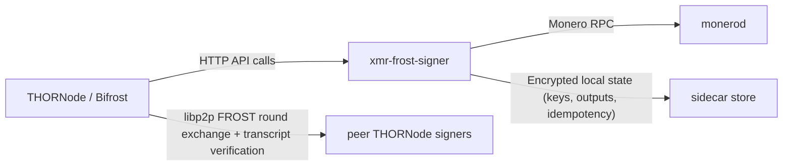

# XMR Integration Design (THORNode + Sidecar)

## Goal

This document explains how the XMR integration works in THORNode, with emphasis on the boundary between THORNode/Bifrost and the `xmr-frost-signer` sidecar, and why responsibilities are split the way they are.

## Components

- THORNode core: chain state, vault/churn policy, outbound scheduling, observation consensus.
- Bifrost Monero chain client: THORNode adapter for XMR (`bifrost/pkg/chainclients/monero`).
- go-tss FROST coordinator: peer coordination over libp2p (`bifrost/tss/go-tss/tss`).
- `xmr-frost-signer` sidecar: local Rust process for Monero/FROST cryptography, wallet scanning state, and daemon RPC.
- Monero daemon: canonical chain data and tx relay.

## Provenance

The Rust sidecar is consumed as a pre-built Docker image from `registry.gitlab.com/thorchain/devops/serai/xmr-frost-signer`. The pinned version is set in `build/docker/docker-compose.yml` and overridable via `XMR_FROST_SIGNER_IMAGE`.

- The THORNode-specific HTTP service, scanner wiring, and deployment glue live in-tree in this repository.
- The Serai-derived Rust cryptography/request crates are attributed and pinned in `Cargo.toml` to `https://github.com/serai-dex/serai` at rev `737dbcbaa78ab817cc1c435cb2b6c5d24d1c4391`.
- The sidecar keeps its own `LICENSE` file adjacent to source so AGPL obligations for the Rust service remain explicit.

## Boundary: THORNode/Bifrost vs Sidecar

### Transport and trust boundary

- Boundary transport is HTTP between Bifrost and the sidecar endpoint on each node.
- Bifrost side (`sidecar.Client`) enforces:
  - non-loopback endpoint must be HTTPS,
  - non-loopback endpoint must have auth (bearer or basic),
  - required endpoint config for XMR signer path.
- Sidecar requires configured auth at startup (bearer or basic) and enforces authenticated protected routes with per-IP/global rate limits.

### Boundary at a glance



### API contract at the boundary

Bifrost calls sidecar endpoints for:

- DKG: `/v1/monero/dkg/round1`, `/round2`, `/round3`, `/finalize`
- Signing: `/v1/monero/sign/prepare`, `/partial`, `/combine`
- Broadcast: `/v1/monero/broadcast`
- Scan/read: `/v1/monero/scanner/sync`, `/transfers`, `/balance/{vault}`, `/outputs/{vault}`, `/addresses/{vault}`, chain query endpoints
- No standalone vault registration endpoint; vault mapping is committed by DKG finalize.

The authoritative contract is in:

- `bifrost/pkg/chainclients/monero/XMR_TSS_SIGNER_API.md`

## Delegation Matrix

### THORNode/Bifrost/go-tss owns

- Vault membership + signer set from THORChain.
- FROST party formation (`joinParty`) and libp2p message exchange.
- Deterministic participant indexing and round transcript verification.
- Sender-to-peer binding checks and blame attribution.
- Deterministic `msg_id`, DKG context, plan hash/eventuality verification.
- Keygen gating:
  - all signers must be online for DKG,
  - derived address must match expected vault address,
  - sidecar finalize must succeed.
- Observation/attestation to THORChain:
  - observed txs,
  - errata handling,
  - solvency + network fee reporting.
- Reorg orchestration at block-scanner level.

### Sidecar owns

- FROST cryptographic state machines for local rounds (DKG and signing).
- Persistent encrypted key material and vault registry.
- Local tracked output state machine: unspent/reserved/spent.
- Output reservation lifecycle and reconciliation.
- Idempotency storage and replay handling for sign/broadcast endpoints.
- Deterministic decoy selection + Monero tx construction.
- Broadcast submission to monerod.
- Scanner state per vault and block-level output discovery.
- Direct daemon RPC calls and bounded response parsing.

### Intentionally split

- **Consensus/coordination in THORNode**, **private key material + chain-specific crypto in sidecar**.
- Sidecar never performs cross-peer consensus; it only executes local round math.
- THORNode never stores Monero threshold private key material.

## Keygen Flow (DKG)

1. THORNode signer triggers custom keygen hook for XMR after TSS keygen context is ready.
2. Bifrost calls `TssServer.FrostKeygen(...)` with signer set and expected XMR vault address.
3. go-tss:
   - forms party over libp2p,
   - requires full signer participation for DKG,
   - executes round exchange over p2p,
   - calls local sidecar each round for local cryptographic step.
4. Sidecar DKG:
   - round1: generate commitments,
   - round2: verify commitments and produce encrypted shares,
   - round3: derive group key + address, but only stages material.
5. go-tss validates cross-peer consistency and expected address.
6. go-tss calls sidecar `dkg/finalize`.
7. Sidecar finalize atomically registers vault mapping and persists encrypted threshold share.

Design choice:

- Finalization is explicit to avoid persisting key material before network-level agreement and address checks complete.

## Signing and Broadcast Flow

1. THORNode schedules outbound; Bifrost Monero client validates tx intent:
   - featured+guaranteed destination,
   - single XMR coin,
   - sufficient unlocked balance,
   - scanner freshness guard (sidecar rejects stale scan state).
2. Bifrost resolves current vault signer membership and calls `TssServer.FrostKeySign`.
3. go-tss:
   - derives deterministic `msg_id`,
   - runs preprocess/share exchanges over libp2p,
   - uses transcript verification + blame on inconsistencies.
4. Sidecar signing:
   - `prepare`: load key share, build unsigned tx, select decoys deterministically, reserve chosen inputs,
   - `partial`: create local signature share,
   - `combine`: finalize tx, bind reservation to tx hash, persist outgoing attribution.
5. Bifrost validates eventuality tuple (`plan_hash`, `tx_hex_hash`, `eventuality_id`) before accepting signed payload.
6. Broadcast path calls sidecar `/broadcast`; sidecar relays to daemon and finalizes reservations for that `msg_id`.

Design choices:

- Output reservations are sidecar-local and CAS-protected to prevent concurrent spend races.
- `msg_id` idempotency is enforced at sidecar API level to make retries safe.

## Scanner and Observation Flow

1. Bifrost block scanner queries canonical block data through sidecar chain-query endpoints.
2. For each height, Bifrost calls `scanner/sync` with `(height, tip_height, block_hash, parent_hash, reorg_window)`.
3. Sidecar verifies canonical hash linkage from daemon, performs deterministic rollback/rescan if needed, updates persisted outputs/scan metadata, and returns transfers for that block.
4. Bifrost converts transfers into `TxInItem`, enriches memo attribution (including deferred reference memo lookups), applies observation filters, and attests to THORChain.

Design choices:

- Canonical hash handshake in `scanner/sync` prevents scanning against mismatched history.
- Reorg rollback metadata is persisted sidecar-side, while chain-level errata orchestration remains in Bifrost.

## Why This Boundary

1. Security and blast radius

- Keep Monero threshold key material in a dedicated process with encrypted storage and strict API surface.
- Keep consensus/blame logic in THORNode where signer identity and p2p trust model already exist.

2. Determinism and fail-closed behavior

- Deterministic IDs, transcript hashes, decoy context, and eventuality checks reduce ambiguity across signers.
- Any mismatch (membership, transcript, address, stale scan state, reservation mismatch) fails closed.

3. Operational isolation

- Sidecar can evolve Monero-specific cryptography/scanning without embedding all dependencies into THORNode runtime.
- THORNode keeps chain-agnostic scheduling/attestation responsibilities.

4. Licensing isolation

- Sidecar is intentionally isolated as its own AGPL component, with explicit source/distribution boundary.

## Important Operational Constraints

- XMR sidecar currently uses hard-cutover storage semantics:
  - no legacy runtime compatibility path,
  - no in-place migration,
  - clean sidecar data directory required for cutover upgrade.
- `XMR_FROST_CHAIN_NETWORK` must be explicit (`mocknet`, `chainnet`, `stagenet`, or `mainnet`).
- Sidecar protected routes require configured auth (`XMR_FROST_AUTH_BEARER` or basic auth vars).
- In mainnet mode, sidecar daemon endpoint hardening is stricter (TLS/auth requirements).
- In mainnet mode, `XMR_FROST_STORE_SECRET` must be strong (32-byte hex/base64 equivalent).
- `XMR_FROST_MAX_SIGN_SCAN_LAG_BLOCKS` controls fail-closed signing when scan state is stale (default `3`).

## Bifrost `xmr` Config Migration (Breaking)

Three Bifrost `chains.xmr` config behaviors now fail closed. A previously-working
XMR deployment will refuse to construct the chain client at Bifrost startup until
its config is updated. All three surface as a startup error, not a silent
degradation.

### 1. Signer credentials are separate from monerod credentials

`authorization_bearer`, `username`, and `password` now feed **only monerod**. They
are never forwarded to the signer. The signer reads `signer_authorization_bearer`,
or the `signer_username` / `signer_password` pair (bearer and basic auth are
mutually exclusive, and basic auth requires both halves). A non-loopback
`signer_endpoint` with no signer credentials is rejected.

Before:

```yaml
chains:
  xmr:
    rpc_host: "http://xmr-daemon:18081"
    username: "monerod-user"
    password: "monerod-password"
    signer_endpoint: "https://xmr-frost-signer:8283"
```

After:

```yaml
chains:
  xmr:
    rpc_host: "http://xmr-daemon:18081"
    username: "monerod-user" # monerod only; never sent to the signer
    password: "monerod-password"
    signer_endpoint: "https://xmr-frost-signer:8283"
    signer_authorization_bearer: "<signer-token>" # matches XMR_FROST_AUTH_BEARER
    # or, mutually exclusive with the bearer:
    # signer_username: "signer-user"
    # signer_password: "signer-password"
```

### 2. Plaintext HTTP to a non-loopback signer must be opted into

A non-loopback `http://` `signer_endpoint` is no longer permitted just because the
node is not on mainnet. It now requires an explicit `signer_allow_insecure_http: true`,
and that escape hatch is honored **only** when neither the node network nor
`signer_expected_network` is mainnet. Loopback endpoints (`127.0.0.1`, `localhost`)
are unaffected. A mocknet/stagenet deployment pointed at `http://xmr-frost-signer:8283`
now hard-fails at startup unless it sets the flag (or switches to `https://`).

Before:

```yaml
chains:
  xmr:
    signer_endpoint: "http://xmr-frost-signer:8283" # accepted because network != mainnet
```

After:

```yaml
chains:
  xmr:
    signer_endpoint: "http://xmr-frost-signer:8283"
    signer_allow_insecure_http: true # development/isolated-compose only; ignored on mainnet
```

Mainnet operators must terminate TLS and use an `https://` signer endpoint; the flag
cannot re-enable plaintext there.

### 3. `signer_expected_network` is mandatory

`signer_expected_network` is required on **every** network, including mocknet. Bifrost
rejects an empty value outright, and rejects a signer whose advertised network does not
match. It must equal the signer's `XMR_FROST_CHAIN_NETWORK` (`mocknet`, `chainnet`,
`stagenet`, or `mainnet`). This is what binds a node to the intended deployment and stops
a stagenet signer from being driven by a mainnet Bifrost (or vice versa).

Before:

```yaml
chains:
  xmr:
    signer_expected_network: "" # inferred / unchecked
```

After:

```yaml
chains:
  xmr:
    signer_expected_network: "stagenet" # must equal the signer's XMR_FROST_CHAIN_NETWORK
```

On startup Bifrost additionally requires the signer to advertise the full reviewed
capability contract (protocol, API major, state schema, source revision, and every
required capability) over `/v1/monero/info`. An old or partially-featured signer image
is rejected at construction rather than at first use, so the signer image must be
upgraded in lockstep with Bifrost.

One capability is optional rather than required: `durable-sign-result-recovery-v1`.
It asserts that the signer durably replays combine by `(msg_id, session_id,
all_shares)` -- the signer advertises it alongside the `durable_combine_response`
path, which replays a committed result after a session loss instead of re-signing --
so a retried combine cannot broadcast the same Monero transaction twice. A signer that
advertises it gets bounded combine retries; a signer that does not still runs, but
combine is single-shot, because retrying against a signer without the durable replay
contract risks a double broadcast. It is deliberately not in the required set so that
an older signer image degrades rather than failing to start. The chosen policy is
logged at startup as `idempotent_combine` on the compatibility line.

## Primary Code Anchors

- Bifrost Monero client: `bifrost/pkg/chainclients/monero/client.go`
- Sidecar HTTP client: `bifrost/pkg/chainclients/monero/frost_signer.go`
- go-tss DKG/sign coordinators:
  - `bifrost/tss/go-tss/tss/frost_keygen.go`
  - `bifrost/tss/go-tss/tss/frost_keysign.go`
- Sidecar: consumed as a pre-built Docker image from `registry.gitlab.com/thorchain/devops/serai/xmr-frost-signer`, pinned in `build/docker/docker-compose.yml` and overridable via `XMR_FROST_SIGNER_IMAGE`

## Monero User Flows — Privacy Chain Considerations

### Unknown Sender Model

Monero's ring signatures make it impossible to identify the real sender of a transaction from chain data alone. When Bifrost observes an XMR inbound, the sender is recorded as a deterministic marker address (`xmrunknown1...`) derived from the transaction hash and destination address. This marker signals to THORChain that the real sender is unknowable.

Consequence: **refunds cannot go back to the sender automatically** (unlike BTC/ETH where the sender is visible on-chain). Users must provide an explicit refund address in their memo.

### Swap Memo — Refund Address

The standard swap memo format supports an optional refund address after the destination, separated by `/`:

```text
=:ASSET:DEST_ADDR/REFUND_ADDR:LIMIT:AFFILIATE:FEE
```

For XMR inbound swaps, the refund address is **required**. Without it, a failed swap has no valid address to return funds to (the `xmrunknown` marker is not a real address).

Example — swap XMR to BTC with refund address:

```text
=:BTC.BTC:bc1q.../4refundXmrAddr...:0
```

If the swap fails, funds are returned to `4refundXmrAddr...`. If no refund address is provided and the swap fails, the funds are donated to the pool (unrecoverable).

### Dual-Sided Liquidity (Add Liquidity)

For dual-sided LP with XMR, the order of operations matters for security:

**Recommended: add XMR first, then RUNE.**

1. Send XMR to the vault with memo `+:XMR.XMR:<your_thor_address>`
2. Wait for THORChain to observe the inbound
3. Send RUNE from `<your_thor_address>` with memo `+:XMR.XMR:<your_xmr_address>`

The RUNE side is authenticated by the THOR address signature — only the private key holder can send it. The XMR side is **not authenticated** (unknown sender). If RUNE is added first, an attacker who monitors pending asymmetric LPs could race to send XMR to the vault with a memo referencing their own THOR address, attempting to claim the match.

By adding XMR first, the pending LP waits for the authenticated RUNE side, which cannot be front-run.

**Anti-pattern: add RUNE first, then XMR.**

This exposes the RUNE deposit to a front-running attack where an attacker sends XMR with a memo referencing their own THOR address to claim the match. The attacker's THOR transaction would then complete the dual LP, binding the victim's RUNE to the attacker's address.

### Withdraw Liquidity

Withdraw works normally. The withdraw memo is sent as a RUNE transaction (authenticated), and the XMR portion is returned to the LP's recorded XMR address.
